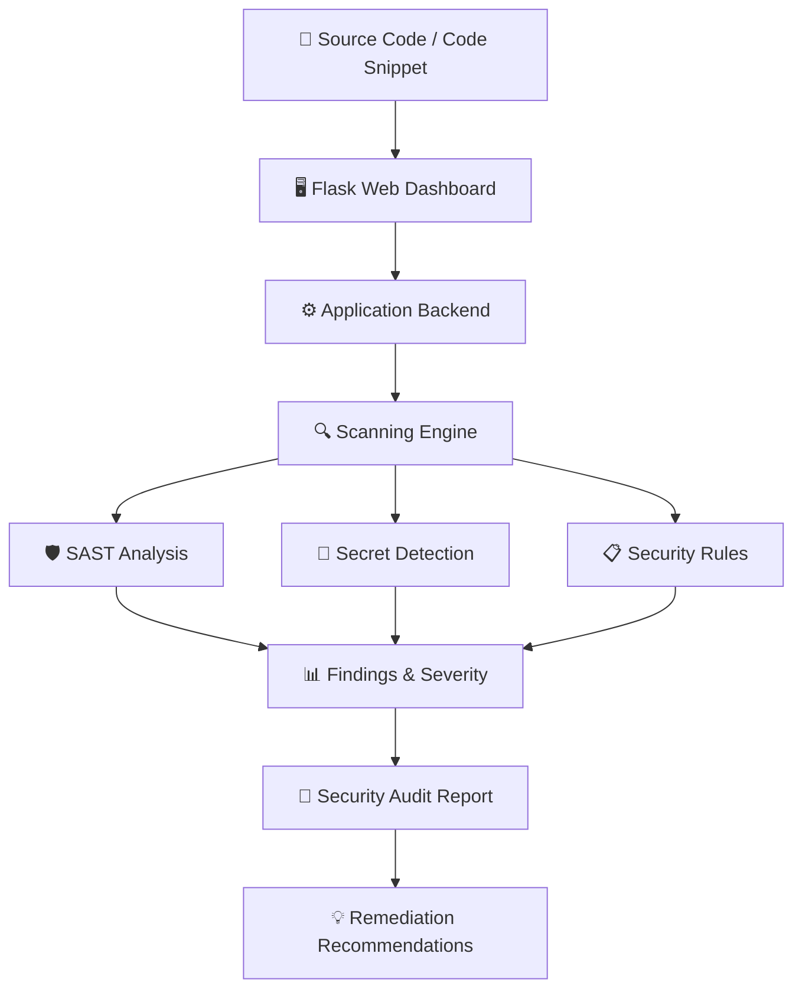

# 🛡️ Secure Audit
### Automated Static Application Security Testing (SAST) Platform

<p align="center">
  <strong>🔍 Detect Vulnerabilities • 🔐 Identify Exposed Secrets • 🚀 Build Secure Applications</strong>
</p>

<p align="center">
  
  
  
  
  
</p>

<p align="center">
  <a href="https://github.com/YashwanthL18/secure-audit">Repository</a> •
  <a href="https://github.com/YashwanthL18/secure-audit/issues">Report an Issue</a> •
  <a href="https://github.com/YashwanthL18/secure-audit/forks">Fork Project</a>
</p>

---

## 📖 About The Project

**Secure Audit** is a Python and Flask-based web application designed to identify potential security vulnerabilities and insecure coding practices in source code.

The project aims to help developers and cybersecurity enthusiasts discover security weaknesses during the software development process, before applications are deployed.

It provides a web-based interface for code security assessment, vulnerability identification, severity classification, and remediation guidance.

### 🎯 Project Objectives

- 🔍 Identify potentially vulnerable source code patterns.
- 🔑 Detect exposed credentials and hardcoded secrets.
- 🛡️ Assess common application security weaknesses.
- 📊 Classify security findings according to severity.
- 💡 Provide recommendations for improving code security.
- 🚀 Encourage secure software development practices.

---

## ✨ Core Features

| Feature | Description |
|---|---|
| ⚡ Code Scanning | Analyze source code for potentially insecure patterns. |
| 🔐 Secret Detection | Identify potentially exposed credentials and API keys. |
| 💉 SQL Injection Detection | Identify unsafe SQL query construction. |
| ⚙️ Command Injection Detection | Identify potentially dangerous command execution patterns. |
| 🌐 XSS Detection | Identify potentially unsafe web content handling. |
| 📁 Path Traversal Detection | Identify suspicious file path operations. |
| 🔑 Cryptography Checks | Flag potentially weak hashing algorithms. |
| 📊 Severity Classification | Categorize findings into four severity levels. |
| 💡 Remediation Guidance | Suggest security improvements for detected issues. |

*Detection capabilities depend on the implemented scanning rules and supported source-code patterns.*

---

## 🛡️ Supported Vulnerability Categories

| Icon | Vulnerability | Potential Security Impact |
|---|---|---|
| 💉 | SQL Injection (SQLi) | Database exposure and unauthorized data manipulation |
| ⚙️ | Command Injection | Unauthorized system command execution |
| 🌐 | Cross-Site Scripting (XSS) | Malicious script injection |
| 📂 | Path Traversal / LFI | Unauthorized file access |
| 🔐 | Hardcoded Credentials | Exposure of passwords, tokens, and API keys |
| 🔑 | Weak Cryptography | Inadequate data protection |

### 🚦 Vulnerability Severity Levels

| Severity | Description |
|---|---|
| 🔴 CRITICAL | Potentially severe security vulnerability |
| 🟠 HIGH | Significant security weakness |
| 🟡 MEDIUM | Moderate security concern |
| 🟢 LOW | Lower-impact security issue |

---

## 🏗️ System Architecture

Secure Audit follows a modular architecture that separates the web interface, application backend, and security scanning components.



---

## 💻 Technology Stack

| Technology | Purpose |
|---|---|
| 🐍 Python | Core application and scanning logic |
| 🌶️ Flask | Web application framework |
| 🌐 HTML5 | Web interface structure |
| 🎨 CSS3 | Dashboard styling |
| ⚡ JavaScript | Frontend interactions |
| 🧪 Pytest | Automated testing |
| 🐙 Git & GitHub | Version control and collaboration |

---

## 📁 Project Structure

The repository contains the application inside a nested project directory.

```text
secure-audit/
│
├── Secure_Audit/
│   │
│   └── Secure_Coding_Assessment_Prototype/
│       │
│       └── [Application Source Files]
│
├── .gitignore
├── LICENSE
└── README.md
```

The application directory contains the implementation files. Its exact internal structure should be documented after inspecting the source code.

---

## 🚀 Installation & Execution (Linux / Kali Linux)

Follow these instructions to set up Secure Audit on a Linux system.

### 1️⃣ Install Prerequisites

```bash
sudo apt update

sudo apt install git python3 python3-pip python3-venv -y
```


### 3️⃣ Navigate to the Application Directory

```bash
cd secure-audit/Secure_Audit/Secure_Coding_Assessment_Prototype
```

### 4️⃣ Create a Python Virtual Environment

```bash
python3 -m venv .venv
```

### 5️⃣ Activate the Environment

```bash
source .venv/bin/activate
```

### 6️⃣ Install Dependencies

If `requirements.txt` exists in this directory:

```bash
python -m pip install --upgrade pip

pip install -r requirements.txt
```

### 7️⃣ Run the Application

If the Flask entry point is `app.py`:

```bash
python app.py
```

### 8️⃣ Open the Web Dashboard

Visit:

```text
http://127.0.0.1:5000
```

To stop the application:

```text
CTRL + C
```

**Note:** Confirm the actual application entry point and dependency file locations before executing these commands.

---

## 🧪 Running Tests

If the project includes a Pytest test suite, execute:

```bash
pytest
```

For detailed test output:

```bash
pytest -v
```

To execute a specific test file:

```bash
pytest tests/test_scanner.py -v
```

---

## 📊 Sample Security Audit Report

Example of a structured vulnerability assessment result:

```json
{
  "audit_status": "COMPLETED",
  "total_vulnerabilities": 2,
  "findings": [
    {
      "id": "SEC-001",
      "rule": "SQL_INJECTION",
      "severity": "CRITICAL",
      "line": 42,
      "recommendation": "Use parameterized SQL queries."
    },
    {
      "id": "SEC-002",
      "rule": "HARDCODED_SECRET",
      "severity": "HIGH",
      "line": 12,
      "recommendation": "Store credentials securely using environment variables."
    }
  ]
}
```

*This is an illustrative report format, not a claim of a verified live scan.*

---

## 🖥️ Application Screenshots

Screenshots of the actual application can be added here to demonstrate its interface and functionality.

Recommended screenshots:

| Screenshot | What to Show |
|---|---|
| Dashboard | Main Secure Audit interface |
| Code Input | Source-code upload or input interface |
| Scanning | Security scanning process |
| Results | Detected vulnerabilities |
| Audit Report | Severity classifications and recommendations |

To add screenshots, create an `assets` directory in the repository and reference the images:

```markdown

```

---

## 🔒 Security & Responsible Usage

Secure Audit is intended for defensive security assessment, educational use, and secure software development.

- Only analyze code you own or have permission to assess.
- Validate findings manually before treating them as confirmed vulnerabilities.
- Never upload real credentials or sensitive production data.
- Keep dependencies updated.
- Do not use automated scanning as a replacement for comprehensive security testing.

---

## 🤝 Contributing

Contributions are welcome!

1. Fork this repository.
2. Clone your fork.
3. Create a new feature branch.
4. Implement your improvements.
5. Test your changes.
6. Submit a Pull Request.

Example:

```bash
git checkout -b feature/new-security-rule

git add .

git commit -m "Add new security detection rule"

git push origin feature/new-security-rule
```

---

## 📜 License

This project is distributed under the **MIT License**.

See the [LICENSE](LICENSE) file for details.

---

## ⭐ Support the Project

If you find this project useful:

- ⭐ Star the repository.
- 🍴 Fork the project.
- 🐛 Report bugs.
- 💡 Suggest improvements.
- 🤝 Contribute new security detection rules.

<p align="center">
  <strong>🛡️ SECURE AUDIT</strong>
  <br/>
  <em>Detect Early. Fix Fast. Build Secure.</em>
</p>
